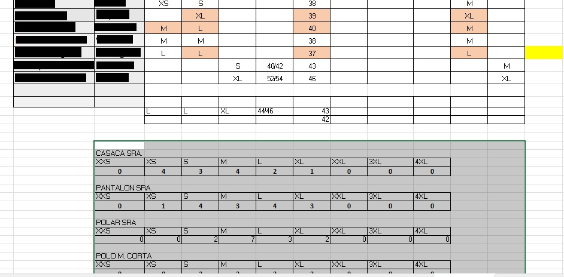
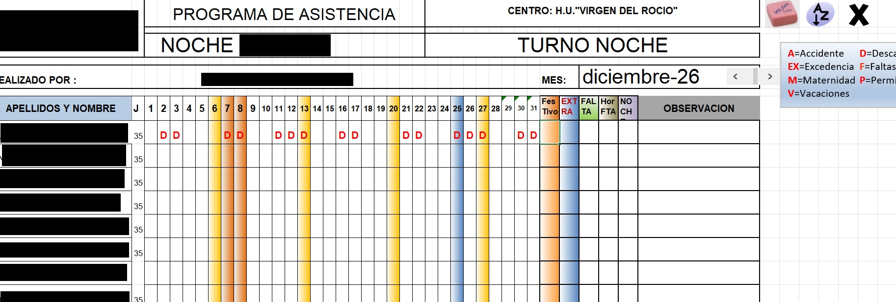

# Transcripción de la Reunión con el Cliente

**Analista de requisitos (Jaime):** Buenas tardes. ¿Podría explicarme a grandes rasgos como trabaja usted actualmente? 

**Cliente:** Buenas tardes, verás, así a gran escala lo que yo hago con la aplicación es controlar los trabajadores que acuden al trabajo, los trabajadores sobre los que tengo disponibilidad y los que ejercen el trabajo cada día, excluyendo los que tienen permisos, o los que tienen licencias, es decir, aquellos que por causa justificada no vienen a trabajar (motivos familiares, citas médicas, etcétera). También hay compañeros que están de baja, en sus respectivas vacaciones. Todo eso lo he de llegar a ver a través de la pantalla. 

**Jaime:** Y eso, ¿con qué fin lo quieres almacenar? 

**Cliente:** Porque depende de los trabajadores, hay que cuadrar para que haya siempre… Hay un número de sitios que hay que tener cubiertos, y en la pantalla he de ver las personas que tengo cada día. Todo va anotado en la misma plantilla. 

**Jaime:** Entonces, tú tienes una plantilla con todos tus trabajadores, y vas poniendo en un calendario donde van cada día, sus puestos de trabajo, si han ido a trabajar o no, la hora a la que han salido de trabajar, ¿no? ¿Qué más datos deseas tener de un empleado, en su día a día? 

**Cliente:** Del día a día creo que con eso es todo. 

**Jaime:** Vale, ¿y puede decirme las distintas áreas que han de ocupar los trabajadores en sus respectivos puestos de trabajo? 

**Cliente:** Claro. Hay que cubrir diversas zonas del hospital para que funcione dignamente. Por ejemplo, en cocina necesitamos dos personas para limpiar la cocina entera por la noche. En el área maternal debemos disponer de otros dos compañeros. En el sector infantil precisamos de un trabajador y en ocasiones hay que recurrir a algún compañero de refuerzo. En traumatología también dos personas. En una visión general, son cuatro sectores o áreas a cubrir por los trabajadores, ¿vale? Y en cuanto a lo del refuerzo, normalmente tenemos a una persona de ayuda o apoyo que realiza algunas tareas complementarias cuando no es necesario cubrir ningún puesto de trabajo, y si por contra hiciese falta se encarga de ocupar dicho puesto. 

**Jaime:** Perfecto. ¿Esos son todos los puestos que desearía completar? 

**Cliente:** Esos son todos los puestos que hay que cubrir en la noche, independientemente de que surja un evento extraordinario ya que el hospital no se puede quedar sin personal de noche. Un acontecimiento inesperado o extraordinario podría llegar a ser una riada en un centro hospitalario. Pero han de taparse los huecos de forma indiferente ante cualquier incidencia como digo. 

**Jaime:** Vale, genial. Y ahora, ¿puedo preguntarte por todos los tipos de ausencia que puede tener un trabajador? Antes mencionaste el tema de los días de permiso y tal. Entonces bien, ¿Por qué motivo podría llegar a falta un trabajador? 

**Cliente:** Un trabajador puede llegar a faltar, en primer lugar, por disponer de un permiso como decía. Nosotros, vamos acumulando permisos, debido a que tenemos un turno rotatorio. Por ese turno rotatorio, los 14 días de permiso del año no podemos seleccionarlos cuando queramos, porque el hospital ha de ser cubierto todos los días. También puedes ausentarte por licencia, vacaciones, baja,o descanso.

**Jaime:** Vale. Estoy viendo que dispones de más funcionalidades en tu hoja de trabajo. ¿Puedes explicarlas? 

**Cliente:** Sí, bueno, independientemente de esta página en la que veo el día a día y el mes, también disponemos de otra página en la que enlazo cada nombre con su ficha. 

**Jaime:** ¿Y qué es esa ficha? Cuéntame. 

**Cliente:** En esa ficha tenemos puesto el nombre de la persona. Es, por así decirlo, una ficha personal asociada a cada trabajador. Y en esa ficha se indican los permisos que coge o ha de coger cada persona a lo largo del año. 

**Jaime:** ¿Por qué el trabajador, tiene que escoger una serie de días obligatoriamente como mínimo? 

**Cliente:** Sí. Nosotros tenemos que seleccionar como permiso, como he dicho antes, los días festivos, días de libre disposición, o un domingo a elegir durante el año. ¿Vale? Pues todos esos días están puestos en un cuadrante, junto con el día que se disfruta, y el día que se solicita. Si una persona solicita descansar el nueve de febrero, yo anoto en una lista que desea pedir el día de descanso, y si finalmente coge ese día, vuelvo a anotar en la lista pero esta vez el día en el que lo disfruta. 

**Jaime:** Porque se ha de distinguir entre el día de la solicitud y el día en el que puede disfrutar del permiso ¿no? 

**Cliente:** En efecto. El trabajador me solicita un día. Todavía no sé si se lo podré dar, porque desconozco la necesidad de trabajadores que voy a tener. Una vez que ya lo ha cogido, se lo marco como disfrutado y en su misma ficha tengo los días que le faltan por solicitar. 

**Jaime:** ¿Cuántos días puede llegar a tener una persona a lo largo del año? 

**Cliente:** De licencia, no existe límite. Cada vez que se de una intervención de un familiar, por ejemplo, son cinco días por ley. Sin embargo, si es un familiar de segundo grado son tres. Y por ciertos motivos propios (intervención propia, examen, etcétera) también tiene un día. En definitiva, esto va según la ley. 

**Jaime:** ¿Qué más proporciona tu programa? ¿Qué más hace? 

**Cliente:** Vale. Más allá de la ficha, y del puesto de trabajo, también tengo un listado de los trabajadores. En este veo los datos que tenía en las otras fichas, pero agrupados en la misma página. Los días que le quedan por pedir,los días que le quedan hasta la fecha. 

Poseemos una relación de vacaciones. Seguimos un sistema rotativo de vacaciones. Un trabajador coge las vacaciones en julio, al año siguiente las coge en agosto, y al año siguiente las coge en septiembre, y vuelta a empezar. Si quiere cambiarlas, solicita un cambio de vacaciones, que una vez se apruebe, se anota en un cuadrante, para indicar las personas que se van de vacaciones y el número de personas que necesito sustituir. 

**Jaime:** ¿Con sustituir te refieres a contratar gente nueva? 

**Cliente:** Claro, hay que meter gente con contrato para cubrir los huecos de las personas que se van de vacaciones. 

**Jaime:** ¿Qué tienen que hacer los trabajadores para solicitar un cambio de vacaciones? 

**Cliente:** Únicamente presentar una solicitud por escrito. También tendrían que solicitar por escrito los días que quieren descansar. Cada trabajador dispone de una tarjeta para picar, que es obligatoria por ley, en la que se registra su entrada y salida. 

**Jaime:** Háblame más sobre la tarjeta. 

**Cliente:** La tarjeta es identificativa para cada trabajador, y digital. Cuando se entra cada trabajador ha de picar en un “pica digital”, donde se registra la hora a la que entra, la hora a la que sale, y el cúmulo de horas que posee cada trabajador. Esto ha sido impuesto por el gobierno para evitar que se trabajé más o por contrario que se trabajé menos. 

También tengo una relación con los uniformes de cada trabajador, los tipos de ropa que hay: casaca, pantalón, polito, chaleco, camisa… A cada trabajador le tengo anotadas las tallas, para que, cuando se vayan a solicitar los uniformes, me aparezca cuantos he de pedir de cada tipo. Independientemente, siempre hay que tener una previsión, porque las personas que entran para sustituir han de tener también su propia ropa. 

También existe otro documento denominado estadillo, que es el documento oficial que va a la oficina, donde se indica, para cada trabajador, que situación ha tenido. Si ha estado de permiso se marcará con una P, si ha estado de descanso con una D, si ha trabajado se indica con una T , si ha estado de licencia L, B de baja, V de vacaciones, F de faltas. Este es el documento oficial que va a la empresa. Las noches que ha trabajado y los festivos que ha trabajado.

 También anotamos si ha faltado sin causa justificada, o si se ha ido antes sin motivo justificado. Creo que con todo esto es más que suficiente para lo que estoy buscando.  

**Jaime:** Perfecto entonces. Te mantendremos informado del avance del proyecto.